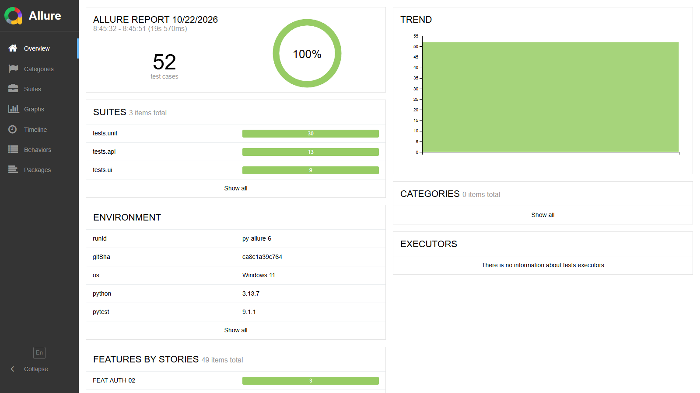
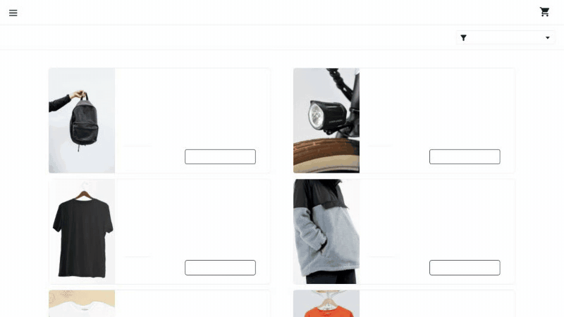
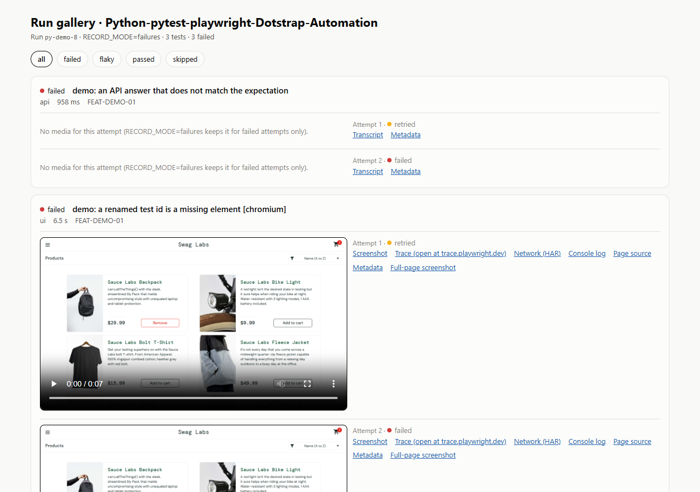
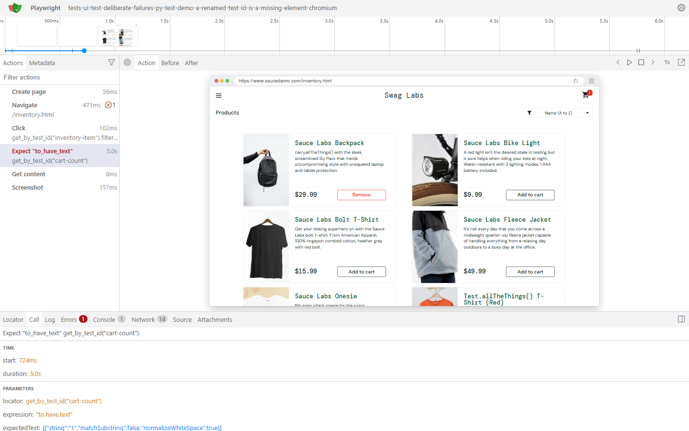
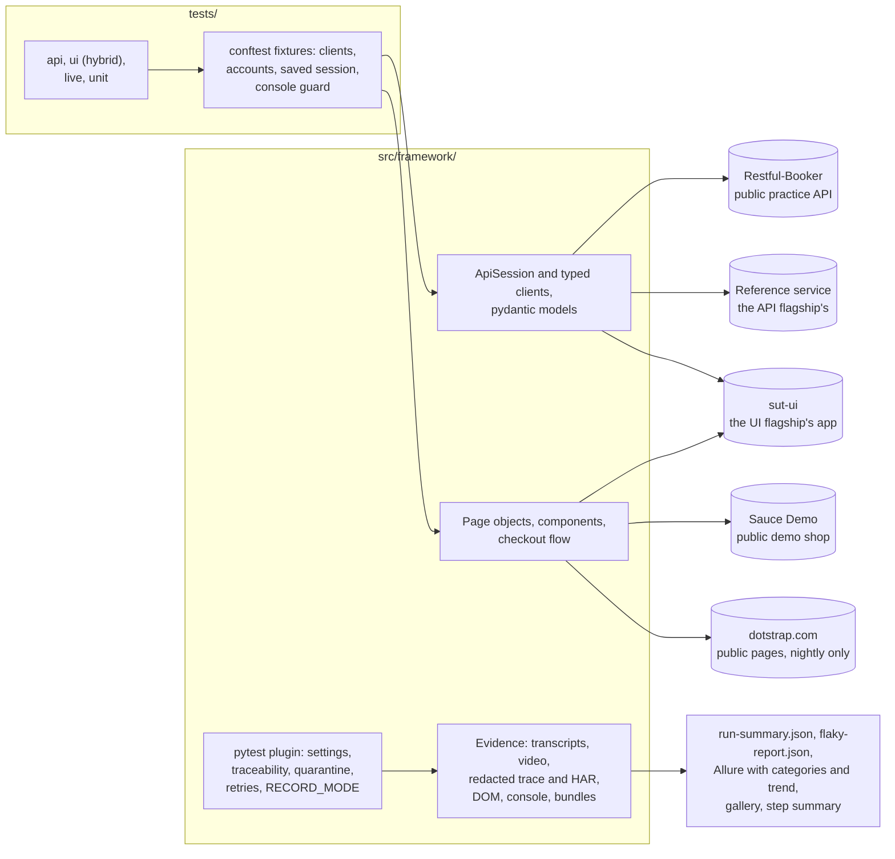

# Python-pytest-playwright-Dotstrap-Automation

Production-style Python test framework: pytest, requests, pydantic, Playwright for Python, Allure,
GitHub Actions, with API and UI tests, a hybrid test that seeds through an API and checks the
browser, a polite live smoke, and failure evidence with video, redacted traces and API transcripts.
The lite Python member of a family of four repositories.

[](https://github.com/kesireddy-kishore-29/Python-pytest-playwright-Dotstrap-Automation/actions/workflows/ci.yml)
[](https://github.com/kesireddy-kishore-29/Python-pytest-playwright-Dotstrap-Automation/actions/workflows/nightly.yml)
[](https://github.com/kesireddy-kishore-29/Python-pytest-playwright-Dotstrap-Automation/actions/workflows/nightly.yml)
[](https://kesireddy-kishore-29.github.io/Python-pytest-playwright-Dotstrap-Automation/)
[](LICENSE)
[](pyproject.toml)
[](pyproject.toml)
[](pyproject.toml)

## See it in 60 seconds

- **Live report:** [Allure with trend and the run gallery](https://kesireddy-kishore-29.github.io/Python-pytest-playwright-Dotstrap-Automation/),
  published by the nightly run. _CI status: first run pending; the images below are from real
  local runs._
- **If you only have 60 seconds**, open:
  1. [`test_items_hybrid.py`](tests/ui/test_items_hybrid.py): seed through the API, check the page,
     check the API again.
  2. [`tests/api/conftest.py`](tests/api/conftest.py): `yield` fixtures that delete their data and
     prove it is gone.
  3. [A failure bundle](docs/examples/failure-evidence/): a UI failure with video and a redacted
     trace, and an API failure with its transcript.





## At a glance

| | |
|---|---|
| Tests | **58** in the default run (36 framework unit tests, 13 API, 9 UI), 5 of them in the smoke; **15** runs of 4 checks in the live smoke; 3 deliberate failures |
| Features traced | **24** feature IDs, shared with the other repositories; a test without one stops collection |
| Runs verified | 2 default runs (`py-allure-7`, `py-allure-8`), 58/58 each, on 2026-10-22 at commit `883cb6d`; smoke 5/5 and live smoke 15/15 the same day (Windows 11, Python 3.13, headless Chromium) |
| Flaky tests | 0 over those 2 runs (a pass on retry is reported as flaky) |
| Stack | Python 3.12+, pytest 9 with pytest-xdist, requests, pydantic 2, Playwright for Python, Allure, ruff, mypy strict, GitHub Actions |
| What is unusual | One recorded `requests.Session` with redacted transcripts; strict pydantic contracts, RFC 7807 problems included; `RECORD_MODE` drives video, tracing and screenshots; the API tests reuse the API flagship's service and the hybrid test the UI flagship's app |
| CI status | Workflows pass actionlint and shellcheck; the first run on GitHub is pending ([known issues](docs/known-issues.md)) |

## What's covered

| Marker | What it verifies | Tests | Feature IDs | Target |
|---|---|---|---|---|
| `api` | Restful-Booker: a token, wrong credentials, writes without a token, create and read back, update, delete, 404. Reference service: 401, 404, 422 and 429 as RFC 7807 problems, an idempotent purchase charged once | 13 runs of 9 tests | 12 | Restful-Booker, the API flagship's reference service |
| `ui` | Sign-in through the form, refused sign-ins, a locked-out user; cart badge, full checkout, order arithmetic on a saved session; the hybrid items test | 9 runs of 7 tests | 7 | Sauce Demo, the UI flagship's app |
| `smoke` | A token, a booking read back, an idempotent purchase, sign-in, a full checkout | 5 | 6 | as above |
| `live` | 9 public pages answer 200 with their heading; no console errors or failed requests; the security headers; no horizontal overflow at 1440, 1024, 768 and 390 px | 15 runs of 4 checks | 4 | dotstrap.com, nightly only |
| `demo_failure` | Fails on purpose: an API answer that does not match, a missing element, a wrong expectation | 3 | 1 | Restful-Booker, Sauce Demo |
| `unit` | The framework itself: redaction (paths and secrets), configuration, run documents, the HTTP session, the repository's rules | 36 | – | none |

The same scenario has the same feature ID in every repository of the family; the rest of each
area is covered by the flagships.

## Run it

Prerequisites: Python 3.12 or later; the Allure report also needs Java.

```bash
python -m venv .venv && . .venv/bin/activate      # 1. a virtual environment (Git Bash: .venv/Scripts/activate)
pip install -e ".[dev]" && playwright install chromium   # 2. install, and the browser
pytest -m smoke -n 2                              # 3. smoke (5 tests), the pull-request gate
pytest -n 4                                       # 4. the default run: unit, API, UI (58 tests)
scripts/allure-report.sh && .allure/allure-2.39.0/bin/allure open allure-report   # 5. Allure with trend
```

Windows PowerShell:

```powershell
python -m venv .venv; .venv\Scripts\Activate.ps1
pip install -e ".[dev]"; playwright install chromium
pytest -m smoke -n 2
pytest -n 4
bash scripts/allure-report.sh; .allure\allure-2.39.0\bin\allure.bat open allure-report
```

`scripts/allure-report.sh` downloads the Allure command line into `.allure/` on first use and
verifies its checksum; on Windows, `bash` comes with Git for Windows.

| Run mode | Command | Output |
|---|---|---|
| Smoke | `pytest -m smoke -n 2` | `run-evidence/Python-pytest-playwright-Dotstrap-Automation/<run-id>/` |
| Default run | `pytest -n 4` | same |
| Framework unit tests | `pytest -m unit` | same |
| Live smoke (public pages, one worker) | `pytest -m live` | same; never committed or published |
| Evidence for every test | `RECORD_MODE=all` before the command (`failures` is the default, `off` keeps none); PowerShell: `$env:RECORD_MODE='all'` | `run-evidence/.../<run-id>/` |
| Deliberate-failure demo | `pytest -m demo_failure` (3 tests fail on purpose) | failure bundles and `gallery.html` in `run-evidence/.../<run-id>/` |

`RUN_ID=<id>` names the run folder; `TEST_RETRIES=0..2` sets retries; every target URL can be set
(`BOOKER_BASE_URL`, `REFERENCE_BASE_URL`, `APP_BASE_URL`, …) as an environment variable or in
`.env`. The reference-service tests need the API flagship's service on :7070 and the hybrid test
the UI flagship's app on :4173; without them those tests are skipped and say why.

## Reports and evidence

| Report | What it shows | Published | Open locally |
|---|---|---|---|
| Allure | Every test with steps and attachments, triage categories, environment, trend | Pages `/allure/` | step 5 above |
| Run gallery | Each test of the run, attempt by attempt, with video and evidence links (the family's shared page) | Pages, latest run | `run-evidence/.../<run-id>/gallery.html` |
| Trace | Every action, DOM snapshot and request, cookie and header values masked, paths relative | inside each UI failure bundle | `playwright show-trace <bundle>/attempt-2/trace.zip` or https://trace.playwright.dev |
| Run summary and flaky report | Per-test results, durations, attempts; tests that passed only on retry | Pages, latest run | `run-evidence/.../<run-id>/run-summary.json`, `flaky-report.json` |

A UI attempt keeps the **video**, the **Playwright trace** (redacted; the raw trace is deleted),
the failure and full-page **screenshots**, the **page source**, the **console** and a redacted
**HAR**; an API attempt keeps a redacted **transcript** of every call; both keep `meta.json`. A
failed test also gets a **failure bundle** (every attempt and a README) and a zip. Examples:
[docs/examples/failure-evidence](docs/examples/failure-evidence/).





## Standards demonstrated

| Practice | Where it is |
|---|---|
| Fixtures instead of base classes; the narrowest cheap scope | [`tests/api/conftest.py`](tests/api/conftest.py), [`tests/ui/conftest.py`](tests/ui/conftest.py), [ADR 2](docs/adr/0002-fixtures-over-inheritance.md) |
| `yield` fixtures that delete their data and prove it is gone | `bookings`, `reference_account`, `app_account` in the conftests |
| A typed client over one recorded `requests.Session` wrapper: timeouts, correlation IDs, logging, redacted transcripts | [`core/http.py`](src/framework/core/http.py), [`api/clients/`](src/framework/api/clients/) |
| Strict pydantic contracts; RFC 7807 problems modelled too | [`api/models/`](src/framework/api/models/), [ADR 3](docs/adr/0003-pydantic-for-contracts-and-config.md) |
| Configuration validated at start-up with pydantic-settings, every problem at once | [`config/settings.py`](src/framework/config/settings.py) |
| Parametrized negatives: 401, 404, 422 and 429, each its own feature ID | [`test_reference_service.py`](tests/api/test_reference_service.py) |
| Idempotency: same key, same body, one charge | the same file |
| Role-first page objects and components with a written locator policy | [`ui/`](src/framework/ui/), [docs/locator-policy.md](docs/locator-policy.md) |
| Sign in once and reuse the saved session (`storage_state`) | `sauce_session` in [`tests/ui/conftest.py`](tests/ui/conftest.py) |
| Hybrid test: seed through the API, check the page, check the API again | [`test_items_hybrid.py`](tests/ui/test_items_hybrid.py) |
| Console-error guard on every page | `_open_page` in [`tests/ui/conftest.py`](tests/ui/conftest.py) |
| `RECORD_MODE` drives video, tracing and screenshots; evidence per attempt with redacted traces and HAR | [`evidence/plugin.py`](src/framework/evidence/plugin.py), [`core/redaction.py`](src/framework/core/redaction.py) |
| Retries capped at two; a pass on retry is reported as flaky | `TEST_RETRIES`, `flaky-report.json` |
| Traceability and quarantine enforced at collection | [`evidence/plugin.py`](src/framework/evidence/plugin.py), [`quarantine.json`](quarantine.json) |
| Parallel workers with one combined run summary | pytest-xdist; `RunSession` in the plugin |
| Allure with triage categories, environment and trend | [`categories.json`](config/allure/categories.json), [`allure-report.sh`](scripts/allure-report.sh) |
| A live production smoke that never gates and never signs in | [`tests/live/`](tests/live/), [`live_pages.json`](src/framework/config/live_pages.json) |
| CI: pull-request gate, nightly with the flagships' services, Pages and a live badge | [`.github/workflows/`](.github/workflows/) |
| Quality gates | `pyproject.toml` as the single configuration, ruff (lint and format, `time.sleep` banned), mypy strict on `src/`, pre-commit, Conventional Commits, a 2 MB file guard, a unit test that refuses raw HTTP or locators in tests |

## Architecture



Tests ask conftest fixtures for clients, accounts and pages; the framework owns every request and
every locator. A pytest plugin enforces traceability and quarantine, drives `RECORD_MODE`, and
writes the evidence that becomes the run summary, the gallery and the Allure report.

## Triage and healing: what's the same and what's not here

The same: feature IDs, the evidence layout (`run-evidence/<repo>/<run-id>/`, `run-summary.json`
schema 1, failure bundles) and the run gallery page are shared with the flagships, and Allure sorts
failures into the flagships' triage categories. Not here: the triage, self-healing and dashboard
tools; for those see the [API flagship](https://github.com/kesireddy-kishore-29/restassured-testng-api-Dotstrap-Automation#self-healing-and-triage)
and the [UI flagship](https://github.com/kesireddy-kishore-29/playwright-typescript-ui-Dotstrap-Automation#self-healing-and-triage).

## Design decisions

- pytest, requests, pydantic and Playwright for Python, from a job-market analysis ([ADR 1](docs/adr/0001-why-pytest-requests-pydantic-playwright.md)).
- Fixtures over base classes; data that cleans up and proves it ([ADR 2](docs/adr/0002-fixtures-over-inheritance.md)).
- pydantic for contracts and configuration ([ADR 3](docs/adr/0003-pydantic-for-contracts-and-config.md)).
- One repository for API and UI tests ([ADR 4](docs/adr/0004-one-repository-for-api-and-ui.md)).
- The live smoke is a polite, read-only visitor ([ADR 5](docs/adr/0005-live-smoke-policy.md)).

All decisions: [docs/adr/](docs/adr/). Every document: [docs/](docs/README.md).

## Real-world origin and family of repos

The scenarios come from the author's own production project, [dotstrap](https://dotstrap.com):
reusing a signed-in session instead of signing in per test, idempotency keys so a retried purchase
never charges twice, two different 429-family outcomes, seeding data through the API and proving it
gone afterwards, and reading what a public page really renders instead of trusting a 200. They are
rebuilt from scratch against public practice targets and the flagships' self-hosted services; no
dotstrap code, configuration or data is used. The only contact with dotstrap itself is the live
smoke: public pages only, no sign-in, no forms, one worker, a user agent that names this project,
never gating a merge, and no video, trace or HAR.

| Repository | Role |
|---|---|
| [restassured-testng-api-Dotstrap-Automation](https://github.com/kesireddy-kishore-29/restassured-testng-api-Dotstrap-Automation) | API flagship in Java, whose reference service the API tests here also use |
| [playwright-typescript-ui-Dotstrap-Automation](https://github.com/kesireddy-kishore-29/playwright-typescript-ui-Dotstrap-Automation) | UI flagship in TypeScript, whose self-hosted app the hybrid test here seeds |
| [selenium-java-testng-ui-Dotstrap-Automation](https://github.com/kesireddy-kishore-29/selenium-java-testng-ui-Dotstrap-Automation) | The same Sauce Demo scenarios in Selenium 4 and Java, same feature IDs |
| **Python-pytest-playwright-Dotstrap-Automation** (this one) | API and UI tests in Python |

## Known limitations

- The workflows have not run on GitHub yet.
- In CI the reference-service and hybrid tests run only when the repository variables point at the
  flagships; otherwise they are skipped.
- Chromium only; Firefox and WebKit are not wired in. Run on Windows 11 only so far.

Details: [docs/known-issues.md](docs/known-issues.md).

## Author

[kesireddy-kishore-29](https://github.com/kesireddy-kishore-29) on GitHub.
