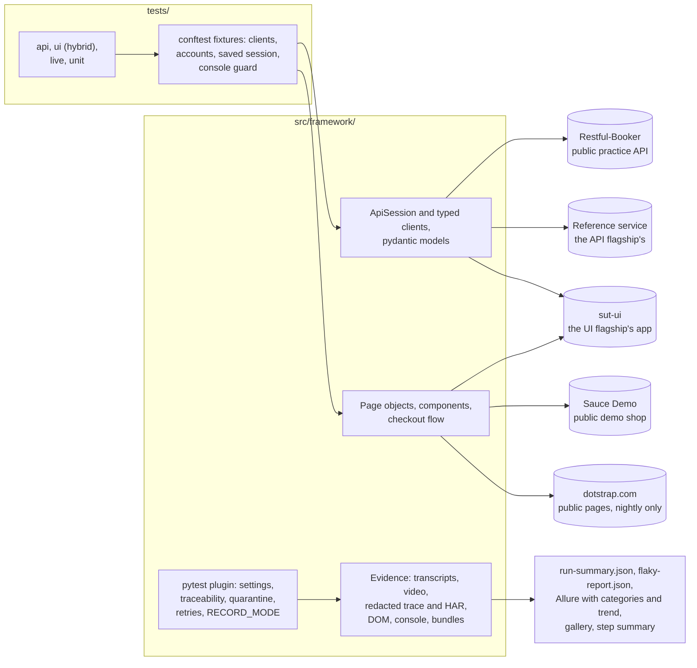

# Python-pytest-playwright-Dotstrap-Automation

API and UI test automation in Python: pytest with fixtures and markers, requests behind a recorded
session, strict pydantic contracts, Playwright for Python with role-first page objects, a hybrid
test that seeds through an API and checks the browser, a polite live smoke of a production site,
and failure evidence with video, redacted traces and API transcripts. The lite Python member of a
family of four repositories.

[](https://github.com/kesireddy-kishore-29/Python-pytest-playwright-Dotstrap-Automation/actions/workflows/ci.yml)
[](https://github.com/kesireddy-kishore-29/Python-pytest-playwright-Dotstrap-Automation/actions/workflows/nightly.yml)
[](https://github.com/kesireddy-kishore-29/Python-pytest-playwright-Dotstrap-Automation/actions/workflows/nightly.yml)
[](https://kesireddy-kishore-29.github.io/Python-pytest-playwright-Dotstrap-Automation/)


| | |
|---|---|
| Tests | 52 in the default run (30 framework unit tests, 13 API, 9 UI), 5 of them in the smoke; 15 runs of 4 checks in the live smoke; 3 deliberate failures. All passed in the latest local runs (the deliberate failures failed, as designed) |
| Run time | About 16 s for the 52 with four pytest-xdist workers; about a minute for the live smoke, one worker |
| Features traced | 24 feature IDs, shared with the other repositories; a test without one stops collection |
| Status | Verified locally on Windows 11 with Python 3.13 and 3.12 and headless Chromium. The workflows (Python 3.12) pass actionlint and shellcheck but **have not run on GitHub yet** ([known issues](docs/known-issues.md)) |

## Standards demonstrated

| Practice | Where it is |
|---|---|
| Fixtures instead of base classes; the narrowest cheap scope | [`tests/api/conftest.py`](tests/api/conftest.py), [`tests/ui/conftest.py`](tests/ui/conftest.py), [ADR 2](docs/adr/0002-fixtures-over-inheritance.md) |
| `yield` fixtures that delete their data and prove it is gone | `bookings`, `reference_account`, `app_account` in the conftests |
| A typed client over one recorded `requests.Session` wrapper: timeouts, correlation IDs, logging, redacted transcripts | [`core/http.py`](src/framework/core/http.py), [`api/clients/`](src/framework/api/clients/) |
| Strict pydantic contracts; RFC 7807 problems modelled too | [`api/models/`](src/framework/api/models/), [ADR 3](docs/adr/0003-pydantic-for-contracts-and-config.md) |
| Configuration validated at start-up with pydantic-settings, every problem at once | [`config/settings.py`](src/framework/config/settings.py) |
| Parametrized negatives: 401, 404, 422 and 429, each its own feature ID | [`test_reference_service.py`](tests/api/test_reference_service.py) |
| Idempotency: same key, same body, one charge | the same file |
| Role-first page objects and components with a written locator policy | [`ui/`](src/framework/ui/), [docs/locator-policy.md](docs/locator-policy.md) |
| Sign in once and reuse the saved session (`storage_state`) | `sauce_session` in [`tests/ui/conftest.py`](tests/ui/conftest.py) |
| Hybrid test: seed through the API, check the page, check the API again | [`test_items_hybrid.py`](tests/ui/test_items_hybrid.py) |
| Console-error guard on every page | `_open_page` in [`tests/ui/conftest.py`](tests/ui/conftest.py) |
| `RECORD_MODE` drives video, tracing and screenshots; evidence per attempt with redacted traces and HAR | [`evidence/plugin.py`](src/framework/evidence/plugin.py), [example](docs/examples/failure-evidence/) |
| Retries capped at two; a pass on retry is reported as flaky | `TEST_RETRIES`, `flaky-report.json` |
| Traceability and quarantine enforced at collection | [`evidence/plugin.py`](src/framework/evidence/plugin.py), [`quarantine.json`](quarantine.json) |
| Parallel workers with one combined run summary | pytest-xdist; `RunSession` in the plugin |
| Allure with triage categories, environment and trend | [`categories.json`](config/allure/categories.json), [`allure-report.sh`](scripts/allure-report.sh) |
| A live production smoke that never gates and never signs in | [`tests/live/`](tests/live/), [`live_pages.json`](src/framework/config/live_pages.json) |
| CI: pull-request gate, nightly with the flagships' services, Pages and a live badge | [`.github/workflows/`](.github/workflows/) |
| Quality gates | `pyproject.toml` as the single configuration, ruff (lint and format, `time.sleep` banned), mypy strict on `src/`, pre-commit, Conventional Commits, a 2 MB file guard, a unit test that refuses raw HTTP or locators in tests |

## Architecture



## What is tested

| Marker | Tests | What it covers | Target |
|---|---|---|---|
| `api` | 13 | Restful-Booker: a token, wrong credentials, writes without a token (2), create and read back, update, delete, 404. Reference service: 401, 404, 422 and 429 as RFC 7807 problems, an idempotent purchase charged once | Restful-Booker, reference service |
| `ui` | 9 | Sign-in through the form, 3 refused sign-ins, a locked-out user; cart badge, full checkout, order arithmetic on a saved session; the hybrid items test | Sauce Demo, sut-ui |
| `smoke` | 5 | A token, a booking read back, an idempotent purchase, sign-in, a full checkout | as above |
| `live` | 4 checks, 15 runs | 9 public pages answer 200 with their heading; no console errors or failed requests; the security headers; no horizontal overflow at 1440, 1024, 768 and 390 px | dotstrap.com, nightly only |
| `demo_failure` | 3 | Fails on purpose: an API answer that does not match, a missing element, a wrong expectation | Restful-Booker, Sauce Demo |
| `unit` | 30 | The framework itself: redaction, configuration, run documents, the HTTP session, the repository's rules | none |

## Traceability

Every test outside `tests/unit` carries `@pytest.mark.feature("FEAT-…")`, also an Allure feature
label. The IDs are the family's: the same scenario has the same ID in every repository. "Family"
counts the area's IDs across the family; "Here" counts those this repository covers.

| Area | Family | Here | Tests | Runs | Marker |
|---|---|---|---|---|---|
| Restful-Booker auth and bookings (`AUTH`, `BOOK`, `NEG`) | 7 | 7 | 7 | 8 | api |
| Reference service (`AUTHZ`, `ERR`, `ACCT`, `RATE`, `IDEMP`) | 9 | 5 | 2 | 5 | api |
| Sign-in (`LOGIN`) | 3 | 3 | 3 | 5 | ui |
| Cart and checkout (`CART`, `CHECKOUT`) | 5 | 3 | 3 | 3 | ui |
| Items, hybrid (`ITEMS`) | 1 | 1 | 1 | 1 | ui |
| Live smoke (`LIVE`) | 8 | 4 | 4 | 15 | live |
| Deliberate-failure demo (`DEMO`) | 1 | 1 | 3 | 3 | demo_failure |
| **Total** | **34** | **24** | **23** | **40** | |

The rest of each area is covered by the flagships.

## Design decisions

- pytest, requests, pydantic and Playwright for Python, from a job-market analysis ([ADR 1](docs/adr/0001-why-pytest-requests-pydantic-playwright.md)).
- Fixtures over base classes; data that cleans up and proves it ([ADR 2](docs/adr/0002-fixtures-over-inheritance.md)).
- pydantic for contracts and configuration ([ADR 3](docs/adr/0003-pydantic-for-contracts-and-config.md)).
- One repository for API and UI tests ([ADR 4](docs/adr/0004-one-repository-for-api-and-ui.md)).
- The live smoke is a polite, read-only visitor ([ADR 5](docs/adr/0005-live-smoke-policy.md)).

## Failure evidence

`RECORD_MODE` decides how much each attempt keeps: `failures` (the default), `all` (nightly and
local analysis), `off`; it drives pytest-playwright's video, tracing and screenshot options. A UI
attempt keeps the video, the Playwright trace (cookie and header values masked, the raw trace
deleted), the failure and full-page screenshots, the page source, the console and a redacted HAR;
an API attempt keeps a redacted transcript of every call; both keep `meta.json`. A failed test also
gets a failure bundle (every attempt and a README) and a zip; the run gets `run-summary.json`,
`flaky-report.json`, a gallery page (the same page as the other repositories) and a step summary.

Two bundles from a real run of the deliberate failures, a UI one with both attempts' videos and an
API one with its transcript, are in [docs/examples/failure-evidence](docs/examples/failure-evidence/),
with the redacted trace [open in Playwright's trace viewer](docs/examples/failure-evidence/trace-viewer.png).

## Real-world origin

The scenarios come from the author's own production project, [dotstrap](https://dotstrap.com):
reusing a signed-in session instead of signing in per test, idempotency keys so a retried purchase
never charges twice, two different 429-family outcomes, seeding data through the API and proving it
gone afterwards, and reading what a public page really renders instead of trusting a 200. They are
rebuilt from scratch against public practice targets and the flagships' self-hosted services; no
dotstrap code, configuration or data is used.

The only contact with dotstrap itself is the live smoke: public pages only, no sign-in, no forms,
no data created, no calls to its backend, one worker, a user agent that names this project, never
gating a merge, and no video, trace or HAR. Its evidence is never published or committed.

## Family of repos

- [**restassured-testng-api-Dotstrap-Automation**](https://github.com/kesireddy-kishore-29/restassured-testng-api-Dotstrap-Automation): the API flagship in Java with REST Assured and TestNG, whose reference service the API tests here also use.
- [**playwright-typescript-ui-Dotstrap-Automation**](https://github.com/kesireddy-kishore-29/playwright-typescript-ui-Dotstrap-Automation): the UI flagship in TypeScript with Playwright, whose self-hosted app the hybrid test here seeds.
- [**selenium-java-testng-ui-Dotstrap-Automation**](https://github.com/kesireddy-kishore-29/selenium-java-testng-ui-Dotstrap-Automation): the same Sauce Demo scenarios in Selenium 4 and Java, with the same feature IDs.
- **Python-pytest-playwright-Dotstrap-Automation** (this one): API and UI tests in Python.

## How to run

You need Python 3.12 or later; the Allure report also needs Java.

```bash
python -m venv .venv && . .venv/bin/activate     # .venv\Scripts\activate on Windows
pip install -e ".[dev]"
playwright install chromium
pre-commit install --hook-type pre-commit --hook-type commit-msg

pytest -n 4                    # unit, API and UI (the flagships' services are optional)
pytest -m smoke -n 2           # the pull-request gate
pytest -m unit                 # the framework's own tests
pytest -m live                 # dotstrap.com public pages, one worker
pytest -m demo_failure         # fails on purpose
scripts/allure-report.sh       # Allure with trend history
```

Switches (environment variables or `.env`): `RECORD_MODE=failures|all|off`, `RUN_ID=<id>`,
`TEST_RETRIES=0..2`, and every target URL (`BOOKER_BASE_URL`, `REFERENCE_BASE_URL`,
`APP_BASE_URL`, …). The reference-service tests need the API flagship's service on :7070 and the
hybrid test the UI flagship's app on :4173; without them they skip. Evidence lands in
`run-evidence/Python-pytest-playwright-Dotstrap-Automation/<run-id>/`. More in the
[test strategy](docs/test-strategy.md), [locator policy](docs/locator-policy.md) and
[known issues](docs/known-issues.md).
